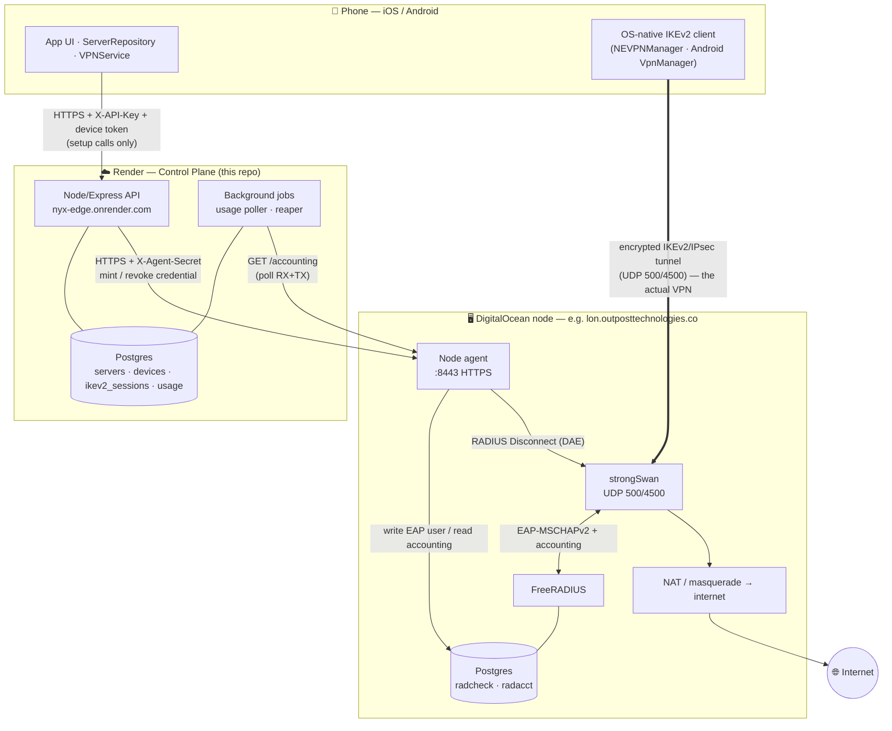
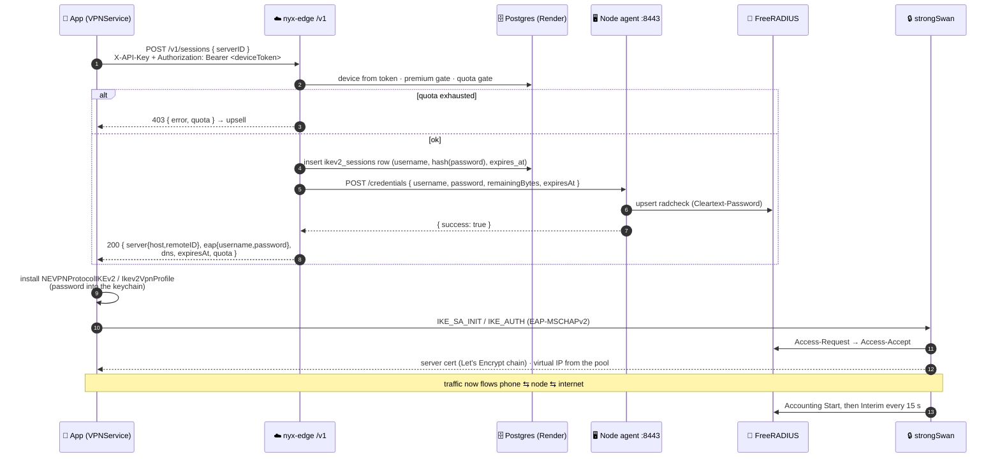
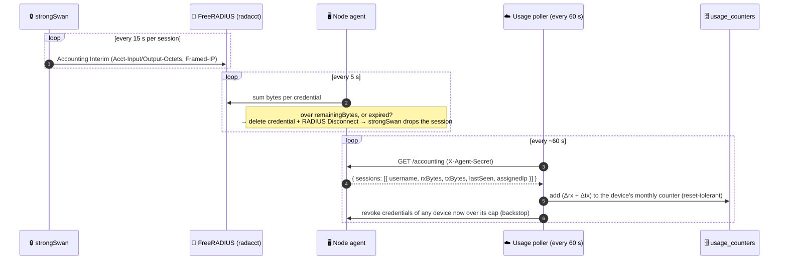
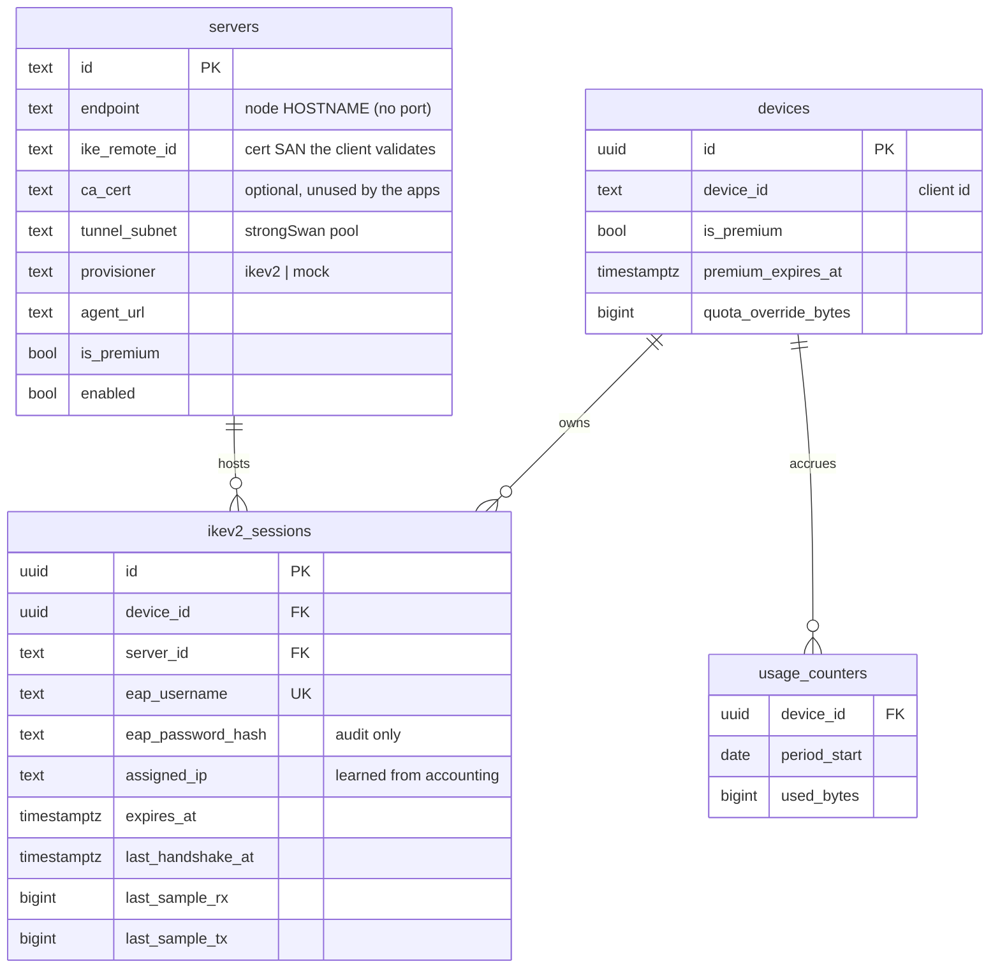

# VPN Master — System Architecture

How the whole thing fits together, end to end: the **iOS and Android apps**, the
**control plane** (this repo, on Render), the **Postgres ledger**, and the
**IKEv2/IPsec nodes** (DigitalOcean droplets). This is the "how it actually works
now" doc — refer to it when you come back to the project.

> Diagrams are [Mermaid](https://mermaid.js.org/) and render on GitHub.

---

## 1. The three planes

There are three independent pieces. The golden rule: **your VPN traffic never
touches Render.** Render is only the coordinator; the encrypted tunnel is
phone ⇆ node.

**Control path** (thin, occasional HTTPS): the app asks the API for the server list and
for a short-lived credential. **Data path** (the real VPN): the phone's native IKEv2
client builds a tunnel straight to the node and its traffic exits to the internet from
there. The API is never in the packet path.

---

## 2. What each piece is

| Piece | Where | Role |
|---|---|---|
| **iOS / Android app** | phone | UI + `ServerRepository` (catalog/session) + `VPNService` → `TunnelManager` (system VPN) |
| **OS IKEv2 client** | phone | `NEVPNProtocolIKEv2` (iOS) / `Ikev2VpnProfile` (Android); validates the server's certificate against system trust |
| **Control plane API** | Render (`nyx-edge.onrender.com`) | `/v1/*`; the only thing the apps talk to over HTTPS |
| **Postgres** | Render (`vpn-master-db`) | servers, devices, per-session credentials, monthly usage ledger |
| **Usage poller + reaper** | Render (in-process jobs) | pull `/accounting` from nodes → ledger + quota enforcement; remove stale sessions |
| **Node agent** | node `:8443` | writes the EAP user into FreeRADIUS, reads its accounting, kicks sessions |
| **strongSwan** | node `UDP 500/4500` | terminates the IKEv2 tunnel; authenticates the client via RADIUS |
| **FreeRADIUS + Postgres** | node (localhost) | checks the EAP-MSCHAPv2 password; records per-session byte counts |

---

## 3. Connecting — the full sequence

Key points:
- The device identity is the **bearer token** (`POST /v1/devices`); a request without a
  valid token is refused (401). There is no client key.
- The credential is **per connect and short-lived** (`IKEV2_CRED_TTL_SECONDS`, default
  24 h); it is the connect-gate. Closing or being reaped revokes it.
- The server certificate is a **publicly trusted Let's Encrypt cert for the node's hostname**,
  so no CA is bundled in the apps. The node sends the full chain.
- The virtual IP comes from strongSwan's pool (`servers.tunnel_subnet`), learned by the
  control plane from accounting — the control plane doesn't allocate IPs.

---

## 4. Quota / metering loop

Postgres is the **ledger** (the authoritative monthly RX+TX total per device); the node is
where traffic happens. They're reconciled by polling, and the node enforces the cap itself.

- **Deltas, not absolutes:** the poller stores each session's last raw reading and adds the
  difference, so counter resets don't double-count.
- **Per device, across nodes:** usage is summed per device for the whole month, even if it
  roams between regions.
- **Free plan:** 1 GB/month (RX+TX combined); premium 10 GB. Served via `/v1/config`.
- **Enforcement latency** ≈ accounting interval (15 s) + sweep (5 s), not instantaneous: a
  fast session can pass its cap by roughly speed × ~20 s. An exact cap would need a
  per-virtual-IP `nftables` quota (not built).

---

## 5. Session teardown & reaping

A device can vanish without a clean disconnect, so credentials don't leak:

- **Explicit:** `POST /v1/sessions/close { serverID, username }` → revoke the credential on
  the node (RADIUS Disconnect) and delete the row. Ownership-checked: a device can only
  close its own session.
- **Automatic (reaper):** removes sessions whose **credential has expired** or that have had
  **no accounting for `PEER_TTL_MINUTES`** (default 30). This relies on strongSwan's interim
  updates (`accounting_interval`).
- **Quota:** the node's sweep and the poller revoke a credential when its device is over cap.

---

## 6. HTTP API (control plane)

All under `https://nyx-edge.onrender.com/v1`, all require `X-API-Key`. Responses are **bare
JSON** (no envelope) and **camelCase**. Device-scoped calls need `Authorization: Bearer <token>`.

| Method | Path | Purpose |
|---|---|---|
| GET  | `/servers` | Server catalog (`?tier=free\|premium`); `available` is true only for real IKEv2 nodes |
| POST | `/devices` | Anonymous device identity → `{ token, expiresAt }` |
| POST | `/sessions` | Mint an EAP credential; returns IKEv2 coordinates + `quota` (token required) |
| POST | `/sessions/close` | Revoke the credential and drop the session (token required, ownership-checked) |
| GET  | `/usage` | Current `quota` for the calling device (token required) |
| GET  | `/config` | Terms/privacy URLs, min version, DNS, plans |
| POST | `/devices/subscription` | Self-declare premium after an App Store purchase (token required) |
| POST | `/devices/premium`, `/devices/quota` | Dev-only toggles, allow-listed by `DEV_UNLIMITED_DEVICE_IDS` |

**Node agent API (on the node, header `X-Agent-Secret`):**

| Method | Path | Body | Purpose |
|---|---|---|---|
| POST   | `/credentials` | `{ username, password, remainingBytes?, expiresAt? }` | add / refresh a credential |
| DELETE | `/credentials` | `{ username }` | remove it + disconnect the live session |
| GET    | `/accounting`  | — | `{ sessions: [{ username, rxBytes, txBytes, lastSeen, assignedIp }] }` |

---

## 7. Data model (Postgres, control plane)

- `usage_counters` is keyed `(device_id, period_start)` — one row per device per month.
- Each node also has its own small Postgres (`radcheck`, `radacct`) — separate from this one.

---

## 8. Security & secrets

| Secret | Lives in | Guards |
|---|---|---|
| `X-API-Key` (`API_KEYS`) | app binary + Render env | every `/v1/*` request |
| Device bearer token (JWT, `JWT_SECRET`) | the device + Render env | which device a request is for (quota, premium) |
| `X-Agent-Secret` (`NODE_AGENT_SECRET` = node `AGENT_SECRET`) | Render env + each node's `agent.env` | control plane ⇆ node agent |
| RADIUS secret, disconnect (DAE) secret, Postgres passwords | `/etc/ikev2-node/secrets.env` on each node | strongSwan ⇆ FreeRADIUS ⇆ agent — all localhost |
| EAP password | minted per connect; in `radcheck` until it expires/closes; in the phone keychain | one tunnel login |

- The hostname is deliberately **neutral** (`nyx-edge`, no "vpn") — networks that do SNI-based
  DPI reset TLS to "vpn"-looking hostnames.
- Phones validate the node's **publicly trusted** certificate, so each node needs a DNS
  hostname and a Let's Encrypt cert (auto-renewed on the node).
- The agent link is HTTPS with a **pinned self-signed cert** (`certs/<id>-agent.crt`, SAN = node IP).
- `:8443` is firewalled to **Render's outbound IP ranges**; if those change the firewall
  drops the control plane silently.

---

## 9. Ports & networking (node)

| Port | Proto | Who | Purpose |
|---|---|---|---|
| 500 | UDP | the world | IKE |
| 4500 | UDP | the world | IKE NAT-T / ESP-in-UDP |
| 8443 | TCP | Render's outbound ranges only | node agent (control path) |
| 80 | TCP | the world | Let's Encrypt issuance/renewal |
| 22 | TCP | you | SSH admin |
| 127.0.0.1 only | — | local | Postgres 5432, FreeRADIUS 1812/1813, strongSwan DAE 3799, agent HTTP 8080 |

Plus IP forwarding, and NAT/MSS-clamp for the pool in ufw's `before.rules`.

---

## 10. Current status

**Working & verified live**
- ✅ Control plane: catalog, per-connect EAP credentials, token-required sessions, quota
  ledger, reaper, usage poller — all IKEv2-only (WireGuard removed).
- ✅ **London (`gb-lon-01`)** on a real strongSwan + FreeRADIUS + agent node, verified with a
  real macOS IKEv2 client: authentication, interim accounting, quota cutoff.
- ✅ Render ⇆ node: Render polls the agent over pinned TLS.

**Pending**
- 🔲 Convert Frankfurt, Singapore, New York (parked as "coming soon" until then).
- 🔲 End-to-end test with the iOS / Android apps against London.
- 🔲 Exact byte cap (per-IP `nftables`), IPv6 for clients, `radacct` pruning.
- 🔲 `render.yaml` drift (service is `nyx-edge`, Postgres 18), IAP receipt validation.

See [`RUNBOOK-add-server.md`](RUNBOOK-add-server.md) for adding/converting a node and
[`BACKEND.md`](BACKEND.md) for the API reference.
